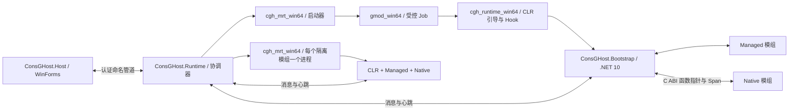

# CGH 架构与运行边界

## 组件

代码分层：`SDK` 只定义模组契约；`Core` 定义元数据、解析与 IPC；`Runtime` 管理会话；`Bootstrap` 在游戏或 MRT 中加载执行模组；`Host` 是 UI。
C++ 公共 SDK 在 `Cpp/include/cgh_sdk.h`，CLR hosting 与 Hook 在 `runtime.cpp/hosting.cpp`，受控进程启动在 `mrt.cpp`。

## 启动与生命周期

1. Host 创建独立 Runtime。以随机令牌和当前用户命名管道握手。
2. Runtime 扫描宿主旁的 `Mods`，校验元数据/程序集/原生位数，解析依赖图，生成会话计划。
3. 每个 `loadAsSubprocess=true` 模组启动一个 MRT，CLR 加载该模组，报告 `loaded`。
4. MRT 启动器创建受控游戏、装入 CGH 原生引导，**在 DllMain 之外**启动 CLR，加载额外 DLL 和进程内模组。
5. 所有端点加载成功后，Runtime 按全局依赖拓扑顺序发送 `Start`，等待逐个确认。失败则回滚。
6. 游戏启动后，原生层匹配 `server.dll!CreateInterface("ServerGameDLL009")`，用 MinHook 接入 `GameFrame`，在引擎线程调用托管与原生 Tick。
7. 退出、模组故障、失联或用户停止：按全局依赖逆序 Stop，关闭端点，关闭 Job，收回本会话创建的进程。

`Load` 适合读取配置、注册服务；跨模组逻辑放 `Start`。同一模组按“映射 Native DLL → Managed.Load → Native.load → Managed.Start → Native.start”执行。
一个模组可以有多个托管入口与多个原生入口，也可以仅含资源。普通 Native DLL 无 `cgh_module_load` 时按依赖库处理。
原生库目录会用 `AddDllDirectory` 注册，但不修改 GMod 的全局默认搜索策略。

`Tick` 是引擎实际帧，不是用计时器伪造游戏帧；没有本地服务端地图时可能没有 GameFrame。
隔离 MRT 的 Tick 为独立的约 50 Hz 工作计时器，无引擎线程访问权；通过消息与进程内模组合作。
模组生命周期和消息分发使用运行时锁序列化；引擎帧遇忙会跳过 CGH 回调，避免等待管理操作。
同步 service handler 可以被多个调用线程进入，模组应自行保证线程安全。

## 两种通信

**同进程快桥**：`IModContext.Call` / `cgh_host_api.call_service`，以 `(modId, service)` 定位；C# 使用 Span，原生使用借用指针，直接同步调用。
不会序列化为 JSON、过网络或管道。最多递归 32 层；返回 -1 缺少服务，-2 异常，-3 响应空间不足。双方都必须遵循 ABI 与缓冲区容量。

**跨进程消息**：`PublishAsync` / `publish` → Runtime 路由 → 各已加载端点的订阅者与 Native.message。
使用 4 字节小端长度前缀和 UTF-8 JSON，二进制载荷为 base64。帧上限 1 MiB，模组载荷上限 256 KiB，输出队列最多 2048 帧。
这条路径优化的是协调与可靠边界，不是共享内存实时数据通道；大规模逐帧数据应留在同进程快桥。
订阅与 Native.message 在 Start 后分发；消息是会话内实时投递，没有持久化重放。

## Hook 与兼容性

内建引擎适配器只接受 GMod 的 `ServerGameDLL009`；GMod 在标准 Source 接口前插入 `PreInit`，因此 `GameFrame` 是从零开始的第 6 槽（七方法前缀），不能使用标准 Source 的第 5 槽。未知版本拒绝猜测。
Native SDK 还暴露任意明确地址的 create/enable/remove Hook；C# 暴露 `CreateHook`。模组必须提供精确调用约定并固定托管 delegate，停止后必须等待自己的回调与线程结束。
CGH 停止时自动禁用模组注册的 Hook；引擎 Hook 的 trampoline 与 DLL 映射保持到进程终止，避免并发回调跳入已释放代码。

本框架不承诺兼容所有 GMod 更新、现有 Lua 二进制模块或第三方注入器。引擎接口、模块行为和游戏实测结果应分别判断。
Native 的访问违规会终止所在进程；隔离模组崩溃会被监督器发现并停止整个会话，避免依赖方继续运行在残缺状态。
CLR 不能从 GMod 进程中卸载，DLL 也不作热卸载；模组变更在下次会话生效。

## 参考依据

- [.NET 原生宿主 API](https://learn.microsoft.com/en-us/dotnet/core/tutorials/netcore-hosting)：hostfxr 与 UnmanagedCallersOnly 的 framework-dependent hosting。
- [GMod Source SDK 接口](https://github.com/danielga/sourcesdk-minimal/blob/master/public/eiface.h)：包含 GMod 特有 PreInit 的帧回调接口契约；它不同于 Valve 通用接口。
- [MinHook](https://github.com/TsudaKageyu/minhook/tree/v1.3.4)：x64 detour/trampoline。
- [Facepunch 二进制模块](https://wiki.facepunch.com/gmod/Creating_Binary_Modules)：GMod Lua 模块与 CGH 自有模组 ABI 的区别。
