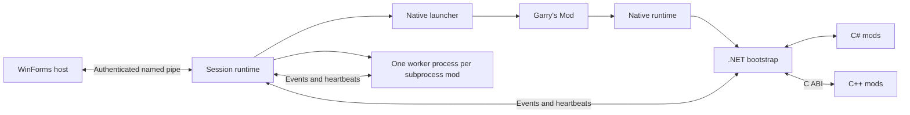

# Architecture

`ConsGHost.Host` is the desktop app. `Core` owns metadata, dependency resolution, configuration, and the wire protocol. `Runtime` supervises a session. `Bootstrap` runs inside the game or a worker, where it loads mods. `SDK` defines the mod API. The native launcher is `Cpp/src/mrt.cpp`, and native hosting lives in `Cpp/src/hosting.cpp` and `Cpp/src/runtime.cpp`. The public C ABI is in `cgh_sdk.h`.

The desktop UI uses named strings in `CSharp/ConsGHost.Host/Localization/`. Add new keys to the base English resource and to each translation, keeping numbered formatting arguments consistent. The host stores its language choice in `cgh_settings.json`. A missing or null `uiLanguage` follows the Windows display language. At runtime, the host switches the interface in place. Host log messages use English in every interface language. The host displays text from mods and other diagnostic sources as received.

## Session lifecycle

1. The desktop host starts a separate runtime and connects over a current-user named pipe with a random token.
2. The runtime scans `Mods/`, validates metadata and binaries, resolves dependencies, and prepares the session and any staged addons.
3. Each mod with `loadAsSubprocess: true` gets its own worker. The worker loads the mod and reports that it is ready.
4. The native launcher starts the controlled game process. The native runtime initializes .NET outside `DllMain` and loads the extra DLLs and in-process mods.
5. After the endpoints finish loading, the runtime calls `Start` in dependency order and waits for each acknowledgment. A failed start rolls back the session.
6. The engine adapter checks `ServerGameDLL009` and dispatches `Tick` and queued engine-thread work from `GameFrame`. A local server must be running for these callbacks. Workers run an independent timer at about 50 Hz.
7. On exit, cancellation, or a failed endpoint, the runtime calls `Stop` in reverse dependency order and closes the job that owns the session processes.

Use `Load` to read settings and register services. Use `Start` for work that depends on other mods. Within a mod, CGH maps native libraries, calls managed `Load`, then native `load`. It calls managed `Start` before native `start`. A mod can contain several managed and native entry points, or consist entirely of resources and addons. Native libraries without `cgh_module_load` can serve as dependencies.

CGH adds native library directories through `AddDllDirectory`. The game retains its default DLL search policy. Mod DLLs stay mapped for the lifetime of their process. Start a new session to pick up changes.

## Communication

### Synchronous calls inside a process

`IModContext.Call` and `cgh_host_api.call_service` locate a handler by mod ID and service name. Callers use a `Span` or a borrowed native buffer. A call returns the number of bytes written, `-1` for a missing service, `-2` for a failed call, or `-3` for insufficient output capacity. The bridge limits nested calls to 32 levels. Handlers can run on multiple calling threads and must handle concurrent access to their own state.

### Messages between processes

`PublishAsync` and native `publish` send events through the runtime to subscribers on loaded endpoints. The pipe protocol uses a four-byte little-endian length prefix and UTF-8 JSON, with binary payloads encoded as Base64. Limits are 1 MiB per frame, 256 KiB per mod payload, and 2,048 frames per output queue. The runtime delivers messages to started mods during the current session. Use the synchronous bridge for large data exchanges within a process.

The bootstrap serializes lifecycle calls and message dispatch. `GameFrame` skips a CGH callback when the lifecycle lock is busy. Calls made through the synchronous bridge run on the caller's thread.

## Engine adapter and process boundaries

The built-in adapter supports Garry's Mod's `ServerGameDLL009` interface. Garry's Mod adds `PreInit` to the interface prefix, placing `GameFrame` at zero-based slot 6. This differs from the generic Source SDK interface. CGH reports an unsupported interface if the expected one is unavailable.

The SDK can register hooks for mods that supply a target and callback with the correct ABI. Keep managed delegates alive and wait for callbacks and background threads to finish before releasing their resources. CGH disables registered hooks during shutdown. The engine trampoline remains available until the game process exits.

A native access violation can terminate the process. A crashed worker causes the runtime to stop the session so dependent mods do not continue with a missing dependency. Worker processes have the same Windows user permissions as the host.

## References

- [.NET native hosting](https://learn.microsoft.com/en-us/dotnet/core/tutorials/netcore-hosting)
- [Garry's Mod engine interface reference](https://github.com/danielga/sourcesdk-minimal/blob/master/public/eiface.h)
- [MinHook 1.3.4](https://github.com/TsudaKageyu/minhook/tree/v1.3.4)
- [Garry's Mod binary modules](https://wiki.facepunch.com/gmod/Creating_Binary_Modules)
